# Enhancing Localization Accuracy for Autonomous Mining Vehicles

UKF sensor fusion in ROS that keeps a mining vehicle localized when GPS drops out, using IMU and LiDAR (AMCL) to carry the pose estimate through tunnels and covered areas.

Master of Mechatronics Engineering capstone, University of Melbourne, 2025 (project M-21-TYIN-004).

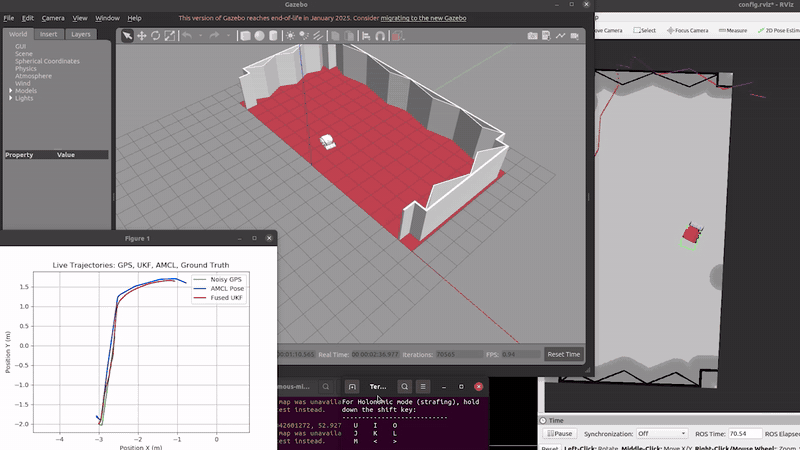

[Full demo video (1:40)](media/demo_full.mp4) · [Project poster (PDF)](media/poster.pdf)

---

## The problem

Autonomous haul trucks rely on GPS. When a truck drives into a tunnel, a covered stockpile or a deep pit, GPS gets weak or disappears. Today the truck usually stops and waits for a remote operator, which costs downtime and staff.

This project builds a localization system that keeps going without GPS. It fuses IMU orientation, LiDAR based AMCL pose and GPS (when available) in an Unscented Kalman Filter, and it changes how much it trusts each sensor depending on signal quality.

## How it works

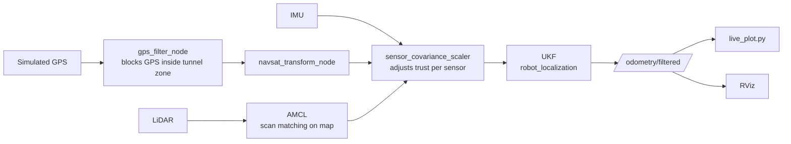

- **UKF state:** `[x, y, θ, ẋ, ẏ, θ̇]` in 2D mode, with a constant velocity motion model.
- **GPS** gives x, y. **IMU** gives yaw and yaw rate. **AMCL** gives x, y and yaw.
- **`gps_filter_node.py`** watches the robot's position in Gazebo. Inside the tunnel zone it stops passing clean GPS and sends a degraded fix with high covariance, so the filter learns to stop trusting it.
- **`sensor_covariance_scaler.py`** rescales each sensor's covariance on the fly. Good GPS gets more weight. Noisy or missing GPS gets less, so the UKF leans on IMU and AMCL instead.

UKF input config (from `src/fusion/config/ukf.yaml`):

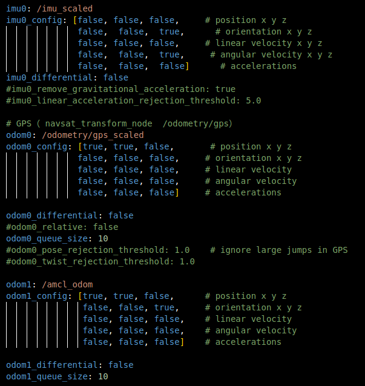

## Simulation

A GPS blocked mine site warehouse was modelled in SolidWorks and loaded into Gazebo with a custom UGV (LiDAR + IMU + GPS). The robot is driven by keyboard. GPS is cut whenever it enters the blocked zone (Y > 0).

| Gazebo world | Map used by AMCL |
|---|---|
| 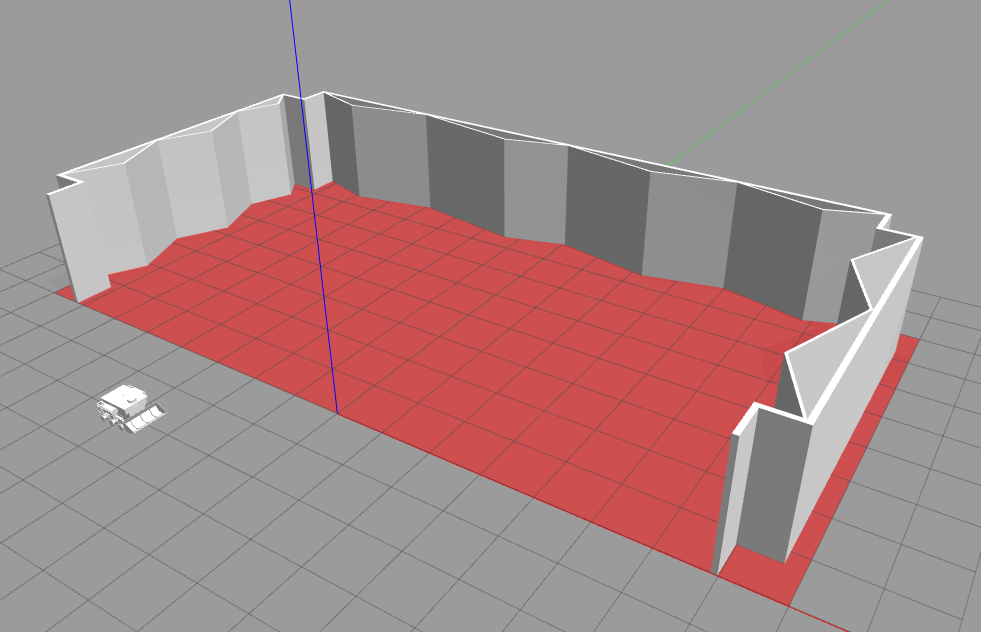 | 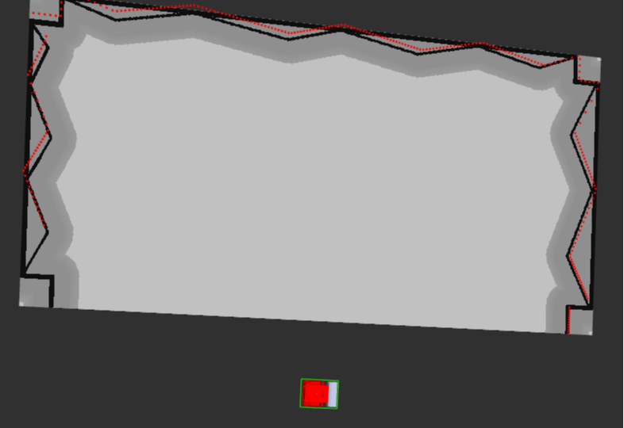 |

## Results

Five runs with GPS cut out partway. **Green** is noisy GPS (used as the reference, and flat where it's blocked). **Blue** is AMCL alone. **Red** is the fused UKF.

| | | |
|---|---|---|
| 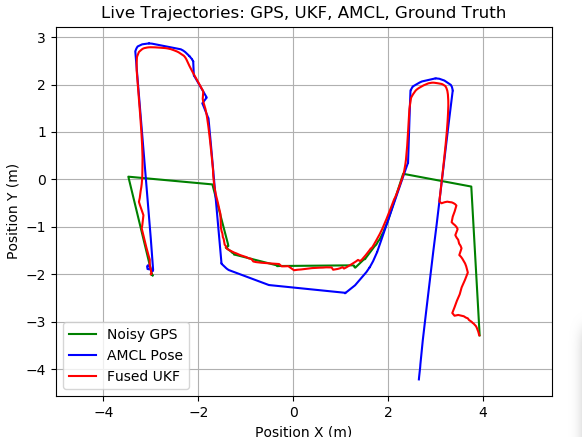 | 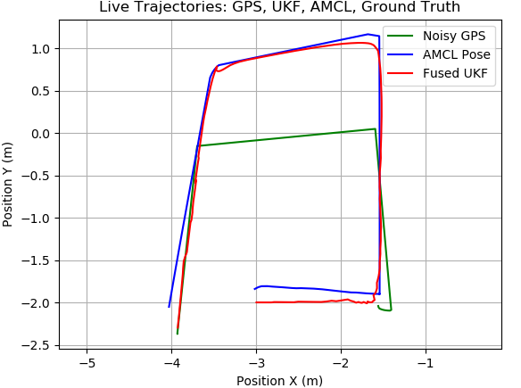 | 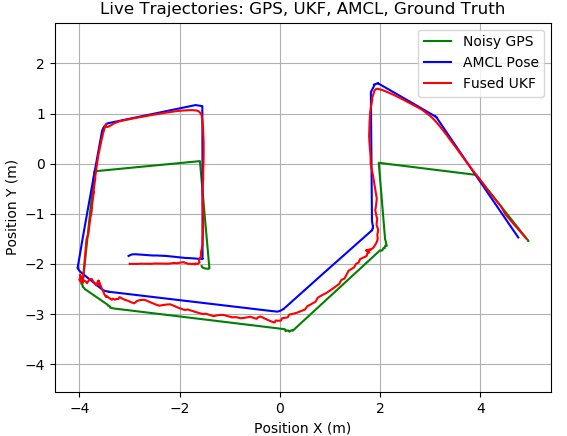 |
| Slight drift near the end | Good tracking | GPS cut out twice |
| 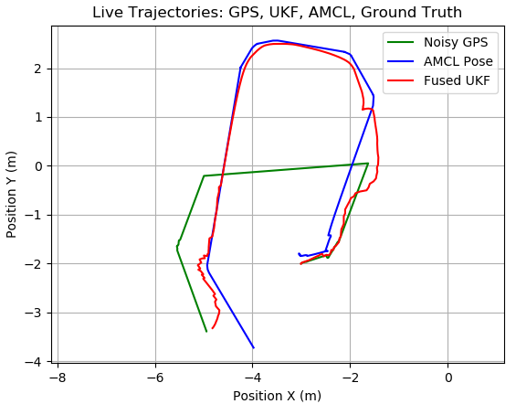 | 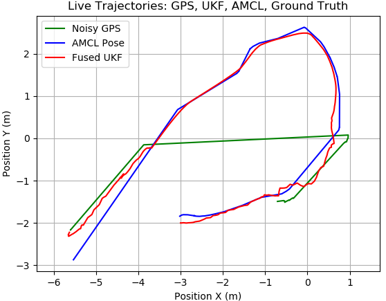 | |
| AMCL misaligned near the end, UKF holds | Good tracking | |

**Error growth.** RMSE against the GPS reference was calculated across 20 logged runs, and a linear model was fitted to RMSE vs distance travelled:

| | Fitted error model |
|---|---|
| AMCL only | RMSE = 0.015 × distance + 0.378 m |
| Fused UKF | RMSE = 0.005 × distance + 0.252 m |

The UKF's error grows about **3 times slower** than AMCL alone. Extrapolated to 1 km, that's roughly 5 m of error versus 15 m. The test runs themselves were short (tens of metres), so read the 1 km figure as a trend, not a measured result.

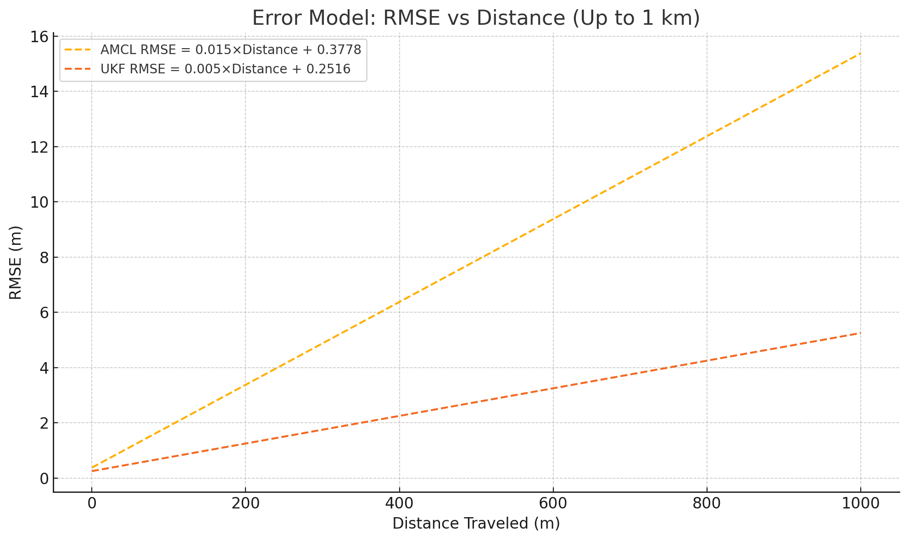

## Hardware prototype: C.H.A.R.O.N

*Cartographic Hybrid Autonomous Robot for Observation and Navigation*

An RC 4WD car with a laser cut acrylic sensor deck (designed in Fusion 360) carrying a **Jetson Xavier**, an **RPLiDAR A1** and a **WT901 IMU**. Cartographer built the map, then AMCL localized against it. It was tested indoors in a building lobby and held stable localization.

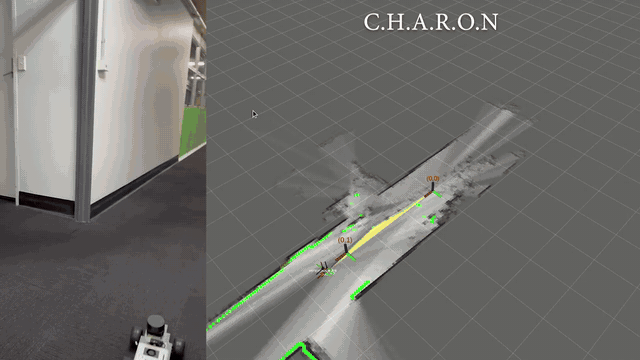

The prototype had no wheel encoders, so AMCL ran with a static TF and fake odometry. A GPS module for the real robot was ordered but never arrived, so the GPS dropout switch was only tested in simulation.

## My contributions

This was a team project. My main work was:

- **`src/fusion/`**: the whole package. UKF config (`ukf.yaml`), launch file and `live_plot.py` for real time trajectory plotting
- **`src/function_layer/move_base/scripts/`**: `gps_filter_node.py` (tunnel zone GPS blocking), `sensor_covariance_scaler.py` (adaptive sensor trust), `sensor_logger_node.py` (CSV logging for analysis)
- **`src/function_layer/nav_config/`**: AMCL setup, `amcl_sim_config.yaml`, `function_layer_sim.launch` and maps
- **`src/simulation/`**: the test site model in `playground_gazebo` and the UGV description (`ugv.xacro`)
- **`cad/`**: SolidWorks models of the test site and tunnel
- **`analysis/`**: Jupyter notebook for trajectory and error analysis

## Repo layout

```
src/
  fusion/               UKF config, launch, live plot          (own work)
  simulation/           Gazebo world, UGV model, Velodyne plugin
  function_layer/       ROS nav stack, AMCL, planners, our scripts and configs
  costmap_converter/    upstream package (needed by TEB planner)
analysis/
  GazeboNB.ipynb        trajectory plots, RMSE, A-UKF experiments
  sample_logs/          one logged simulation run (IMU, GPS, fused odometry)
  early_experiments/    early phone IMU/GNSS dead reckoning scripts
cad/                    SolidWorks + STL models of the test site
media/                  poster, demo video, result figures
```

## Running it

**Tested on:** Ubuntu 20.04, ROS 1 Noetic, Gazebo 11.

```bash
# dependencies
sudo apt install ros-noetic-robot-localization ros-noetic-libg2o \
  ros-noetic-gazebo-ros-pkgs ros-noetic-gazebo-ros-control \
  ros-noetic-diff-drive-controller ros-noetic-joint-state-controller \
  ros-noetic-teleop-twist-keyboard ros-noetic-xacro ros-noetic-joint-state-publisher

# build
mkdir -p ~/catkin_ws && cd ~/catkin_ws
git clone https://github.com/meljohnsony2k/autonomous-mining-vehicle-sensor-fusion.git .
catkin_make
source devel/setup.bash
```

Run each in its own terminal (or use `./run.sh`, which opens them for you):

```bash
roslaunch playground_gazebo playground.launch     # Gazebo, RViz, AMCL, GPS filter, covariance scaler
roslaunch fusion ukf_gps_imu.launch               # UKF + navsat_transform
rosrun fusion live_plot.py                        # live trajectory plot
rosrun joint_state_publisher joint_state_publisher   # if joint states are missing
```

Drive with the keyboard (`i`, `j`, `l`, `,`) and steer into the Y > 0 zone to cut GPS.

## Limitations and next steps

- Tested in simulation and a small indoor space only. Dust, vibration and EMI at a real mine site weren't reproduced.
- The UKF can jitter when IMU and AMCL drift at the same time. It needs more tuning.
- Adding wheel encoders would give proper odometry and remove the fake odometry workaround on the prototype.
- Next step is longer runs in larger, changing environments.

The full capstone report is available on request.

## Team and credits

**Team:** Mel Johnson, Moksh Jacob, Ruoen Xu, Xiaoying Li
**Supervisors:** Prof. Ying Tan, Dr. Jonathan Eden, University of Melbourne

This repo includes open source ROS packages, kept under their original licences:
[ROS navigation stack](https://github.com/ros-planning/navigation) (AMCL, move_base, costmap_2d, planners),
[teb_local_planner](https://github.com/rst-tu-dortmund/teb_local_planner),
[costmap_converter](https://github.com/rst-tu-dortmund/costmap_converter),
[rplidar_ros](https://github.com/Slamtec/rplidar_ros) and velodyne_gazebo_plugins.
Sensor fusion uses [robot_localization](https://github.com/cra-ros-pkg/robot_localization).
